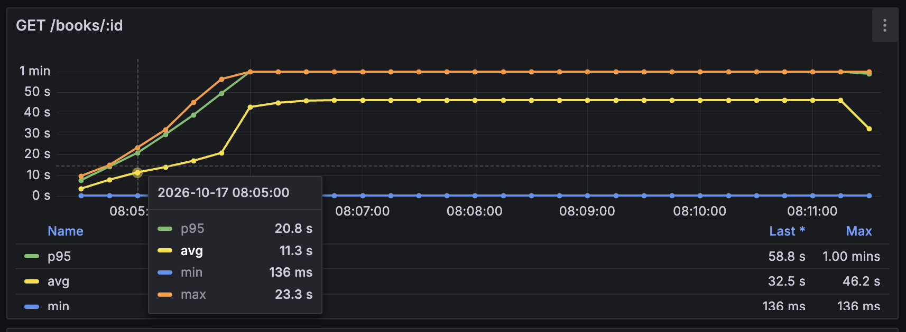
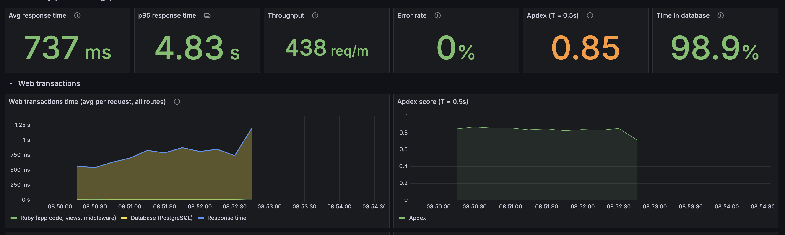
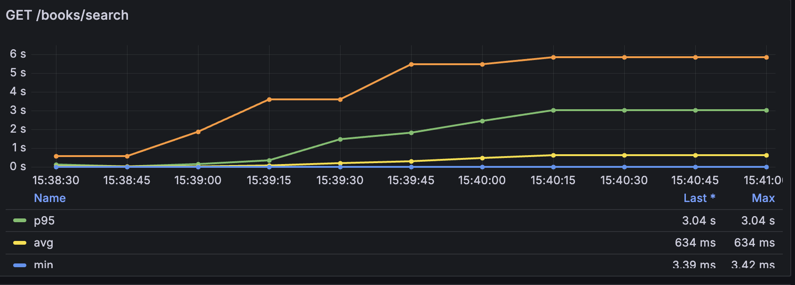

# README

This project is a case study in software architecture. The objective is to adapt the application and its architecture to handle 1,000 requests per second, and possibly grow to 10,000. To validate the architectural evolution, load tests were added to perform real requests to the API and check the response times. To emulate a real scenario, a dump with hundreds of thousands of records was imported into the database to represent an app with a small amount of data.

| Table      | Development | Production |
|------------|------------:|-----------:|
| books      |     356,108 |    356,093 |
| user_books |      21,827 |     21,832 |
| users      |       4,115 |      4,115 |
| subjects   |     152,076 |    152,076 |

## The app

The web app is a simple Ruby on Rails API. It has only seven models representing User, Book, UserBook, Author, Subject, AuthorBook, BookSubject, and UserBook. It's not an application ready for production, nor does it have any business logic. None of the actions has any optimizations in the initial implementation.

## Load tests

The load tests were created using [k6](https://github.com/grafana/k6) to perform the tests, and [grafana](https://github.com/grafana/grafana) dashboards to monitor how the services behave.

The following actions were covered in the load tests, with traffic split between them to emulate the real behavior of a web app.

| Action | Endpoint | Share of traffic |
|---|---|---:|
| Update reading progress | `PATCH /user_books/:id/update_progress` | 25% |
| Create book | `POST /books` | 16.7% |
| Search books by title or author | `GET /books/search` | 16.7% |
| Show user | `GET /users/:id` | 16.7% |
| Show book | `GET /books/:id` | 8.3% |
| Search users by username | `GET /users/search` | 8.3% |
| Create user book | `POST /user_books` | 8.3% |

Before running the load tests using the script `k6/run_load_tests.sh`, the database is re-created using the dump to make sure all tests run under the same conditions. The web app is also run in production to avoid any extra latency added by development tools.

## 1. Initial architecture and first results

The first implementation does not have any optimizations, and the architecture is as simple as possible, using only one instance of the Rails app and one PostgreSQL instance.

Architecture:

Resources:

| Service  | Instances | Workers                                       | CPU     | Memory |
|----------|----------:|-----------------------------------------------|--------:|-------:|
| Rails app | 1        | Puma single mode, 3 threads | 1 vCPU | 2 GB |
| Postgres | 1         | 100 max connections, 8 background workers (8 parallel query) | 1 vCPU | 2 GB |

Results:

Conclusion:

The app can't handle the traffic, and after a few seconds the requests start to time out.

## 2. Increase the number of web app instances

Add more instances of the web app to handle more requests. A load balancer is needed on top of the app instances to split the traffic between them.

Even after adding more replicas of the app and configuring the Nginx load balancer to use the "Round Robin" algorithm to distribute requests between the containers, the performance results are not good as ilustrated in the image below where most og the requests took more than one minute leading to timeout.

This time, however, I felt that more visibility was needed. So I'll add an APM tool to understand where the bottlenecks are. The tools chosed to collect the metrics were Open telemetry to collect metrism and Grafana Tempo to display a dashboard with the metrics collected.

After include the APM tool it's clear that the bottleneck is the database requests, mainly the action `books/search` that is taking too long.

## 3. Add indexes and Database fine tuning

Since the application bottleneck is search books, so the first step is to speed up the query. After add trigram index and change the request query the performance is much better, but we stil facing some errors due to overload of the servers, the averge request is fast something around 800ms, but once the apps are overloaded then the request time becomes much higher.

23% of the planned requests were not done due to server overload, k6 skipped about 14K requests of the planned 60K requests due to all 1000 users been already in use waiting for requests to finish to start new ones.

## 3. Use cache to reduce latency on simple requests
