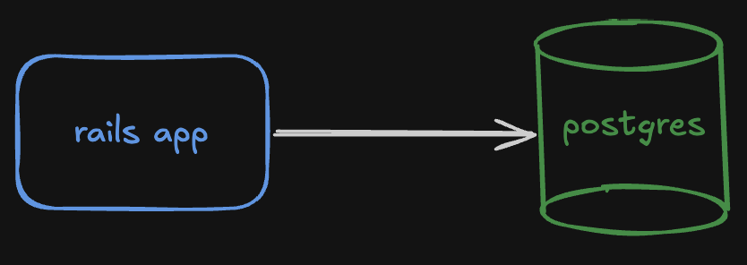
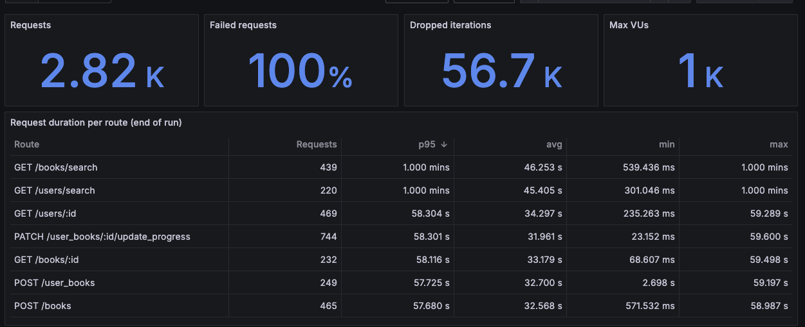

# README

This project is a case of study of software architecture. The objective is to adapt the application and the architecture to handle 1.000 requests per second, maybe grow to 10.000. To validate the architecture evolution was added load tests to perform real requests to the API and check the response times, in order to emulate a real scenario a dump with hundreads os thousands of records were imported in the database in order to represent a app with a small amount of data on it.

| Table      | Development | Production |
|------------|------------:|-----------:|
| books      |     356,108 |    356,093 |
| user_books |      21,827 |     21,832 |
| users      |       4,115 |      4,115 |
| subjects   |     152,076 |    152,076 |

## The app

The web app is a simple ruby on rails api, the app has only seven models that represent User, Book, UserBook, Author, Subject, AuthorBook, BookSubject, and UserBook. It's not a application ready for production nor has any business logics. None of the actions has any optimizations at the first implementation.

## Load tests

The load tests were created using [k6](https://github.com/grafana/k6) to perform the tests, and [grafana](https://github.com/grafana/grafana) dashboards to monitor how the services behave.

The follow actions were covered in the load tests, splitting the traffic between the actions in order to emulate a real behavior of a web app.

| Action | Endpoint | Share of traffic |
|---|---|---:|
| Update reading progress | `PATCH /user_books/:id/update_progress` | 25% |
| Create book | `POST /books` | 16.7% |
| Search books by title | `GET /books/search` | 16.7% |
| Show user | `GET /users/:id` | 16.7% |
| Show book | `GET /books/:id` | 8.3% |
| Search users by username | `GET /users/search` | 8.3% |
| Create user book | `POST /user_books` | 8.3% |

Before run the load tests using the script `k6/run_load_tests.sh` the database is re-created using the dump to make sure all tests run in the same conditions, also the web app is executed in production to avoid any extra latency added by developing tools.

## 1. Initial architecture and first results

The first implementation do not have any optimization, and the architecture as is simple as possible, using only one instance of the rails app and one postgreSQL.

Architecture:

Resources:

| Service  | Instances | Workers                                       | CPU     | Memory |
|----------|----------:|-----------------------------------------------|--------:|-------:|
| Rails app | 1        | Puma single mode, 3 threads | 1 vCPU | 2 GB |
| Postgres | 1         | 100 max connections, 8 background workers (8 parallel query) | 1 vCPU | 2 GB |

Results:

Conclusion:

The app can't handle the trafic, and after a few seconds the requests start to timeout.

## 2. Increase the number of web app instances

Add more instance of the web app to be able to handle more requests, there is needed to add a load balancer on top of the app instances to split the traffice between them.
